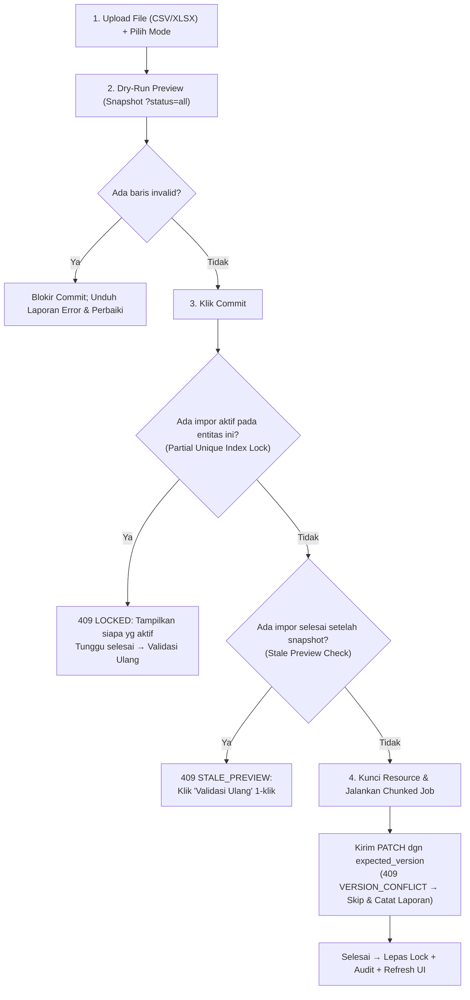

# Dokumen Teknis: Sistem Import Data Multi-Entitas (Console Hub)

**Tanggal:** 2026-11-26  
**Versi:** 1.0 (Draft untuk Review sebelum Implementasi)  
**Cakupan Peran:** Fullstack (`api/` Laravel + `web/` React) — **Portal-Only**  
**Status:** Menunggu Persetujuan Akhir Sebelum Implementasi

---

## 1. Tujuan & Prinsip Desain

Membangun sistem impor data massal untuk 4 entitas utama Console Hub (**User**, **Personel**, **Produksi**, dan **Barang**) melalui file **CSV** dan **XLSX** berbasis template resmi, dengan jaminan keamanan data ketat (*zero-ambiguity*) dan perlindungan penuh terhadap konflik konkurensi lintas pengguna.

### Prinsip & Batasan Wajib
1. **Portal-Only (Tanpa Mengubah 3 Console API):** Seluruh logika parsing, validasi, antrean, dan eksekusi berada di portal (`api/` dan `web/`). Kode maupun database `api-hrd`, `api-gudang`, dan `api-produksi` **tidak dimodifikasi**, dan komunikasi ke 3 console **hanya melalui HTTP API resmi** (`SourceClient` / `ConsoleClient`), dilarang akses DB console langsung (`AGENTS.md`).
2. **Non-Destructive Import:** Impor hanya melakukan **tambah (`create`)** dan **ubah (`update` pada mode Upsert)**. Impor **tidak pernah** menghapus/menonaktifkan baris yang tidak ada di file dan **tidak pernah** mengaktifkan kembali data berstatus `nonaktif`.
3. **Zero-Ambiguity Policy:** Sistem tidak menebak atau melakukan *auto-update* secara heuristik. Setiap potensi duplikat tanpa ID eksplisit akan **dilewati (`skip`)**, dan setiap referensi ambigu akan ditandai **`invalid`** sebelum data apa pun ditulis.
4. **Strict Pre-Commit Gate:** Jika masih terdapat **1 baris `invalid`** pada tahap pratinjau (*dry-run*), tombol eksekusi (*Commit*) **diblokir** hingga seluruh baris error diperbaiki.
5. **Batas Skala & Ramah Server Murah:** Maksimal **300 baris data** (di luar header) dan maksimal **2 MB** per unggahan. Eksekusi ke console API dijalankan lewat *chunked background job* pada queue `default` agar tidak melebihi rate limit `120 req/menit` maupun `--timeout=120` di `api/nixpacks.toml`.
6. **Tanpa Perubahan RBAC Matrix & Tanpa WebSocket/SSE:** Menggunakan ulang (*reuse*) permission RBAC yang sudah ada (`Permission::ALL`), dan pemantauan progres di frontend memakai **polling berkala (2–3 detik)**.
7. **Persetujuan Batas Peran (`AGENTS.md`):** Menambahkan **1 tabel baru** (`data_imports`) di database portal `consolehub_test` (dijaga `App\Support\DatabaseGuard`, mengikuti preseden `report_exports` dan `otp_codes`), tanpa menyentuh infrastruktur cloud maupun `api/nixpacks.toml`.

---

## 2. Peta Entitas & Ketergantungan Data

| Entitas (`type`) | Penyimpanan Pemilik | Endpoint Tujuan | Ketergantungan Referensi | Kunci Unik Alami di Sumber |
|---|---|---|---|---|
| `users` | DB Portal (`consolehub_test.users`) | Lokal Eloquent (`User`) | `roles.code` (lokal portal) | `email` (unique, lowercase) |
| `personel` | Console HR (`api-hrd`) | `/api/v1/people` | Tidak ada (independen) | Hanya `id` (UUID) |
| `produksi` | Console Produksi (`api-produksi`) | `/api/v1/productions` | `courier_id` → Personel `aktif` (HR) | `id` (UUID) & `(lower(area), lower(production_type))` saat `aktif` |
| `barang` | Console Gudang (`api-gudang`) | `/api/v1/items` | `production_id` → Produksi `aktif`, `responsible_id` → Personel `aktif` | Hanya `id` (UUID) |

**Urutan Impor yang Disarankan (untuk data awal/relasional):**
`Personel` → `Produksi` → `Barang` (sementara `User` berdiri sendiri untuk akses portal).

---

## 3. Strategi Konkurensi: Anti-Balapan, Anti-Ketimpa & Anti-Zombie

Untuk mencegah masalah ketika dua pengguna mengimpor data entitas yang sama secara bersamaan (atau ketika Pengguna A baru menonaktifkan/mengubah data lalu Pengguna B mengunggah file lama), sistem **tidak menggunakan waiting list FIFO buta**. Sebagai gantinya diterapkan **4 lapis perlindungan**:



### Lapisan 1 — Per-Resource Active Lock (Database-Level)
- Hanya **1 impor** yang boleh berstatus `queued` atau `processing` untuk setiap `type` pada satu waktu.
- Dijamin secara atomik di tingkat database dengan **Partial Unique Index**:
  ```sql
  CREATE UNIQUE INDEX data_imports_active_type_unique
      ON data_imports (type)
      WHERE status IN ('queued', 'processing');
  ```
- Impor pada entitas berbeda (mis. User A impor `personel` dan User B impor `barang`) tetap dapat berjalan paralel tanpa saling memblokir.
- Jika User B mencoba commit `personel` saat User A masih berjalan, API membalas `409 CONFLICT` (`details.reason = 'RESOURCE_LOCKED'`, `details.active_import = { requester_name, processed_rows, total_rows }`).

### Lapisan 2 — Stale Preview Detection + 1-Klik Validasi Ulang
- Setiap sesi preview menyimpan `validated_at` (waktu snapshot diambil) dan `source_rows` (baris mentah terparse).
- Saat `POST /commit`, backend memeriksa apakah ada `data_imports` dengan `type` yang sama yang memiliki `completed_at > preview.validated_at`.
- Jika ya, commit ditolak dengan `409 CONFLICT` (`details.reason = 'STALE_PREVIEW'`).
- Pengguna cukup menekan tombol **Validasi Ulang** (`POST /imports/{id}/revalidate`) tanpa perlu mengunggah file lagi; backend membandingkan ulang `source_rows` terhadap kondisi server terbaru sehingga perubahan dari impor sebelumnya langsung terlihat di tabel diff.

### Lapisan 3 — Optimistic Locking (`expected_version` / `updated_at`)
- Saat preview untuk mode `upsert`, setiap baris beraksi `update` merekam **`expected_version`** (untuk `personel`, `produksi`, `barang`) atau **`expected_updated_at`** (untuk `users`) dari snapshot.
- Saat worker mengeksekusi update:
  - Untuk console API: `PATCH` dikirim dengan `expected_version`. Jika ada pengguna lain yang mengubah atau menonaktifkan baris itu secara manual melalui UI di antara waktu Preview → Commit, console API otomatis mengembalikan **`409 VERSION_CONFLICT`**.
  - Untuk `users`: update hanya berhasil jika `updated_at` cocok dan `is_active = true`; jika berubah, ditolak secara aman.
- Baris yang terkena konflik versi **tidak pernah menimpa perubahan orang lain**, melainkan dicatat sebagai `conflict` di laporan hasil impor.

### Lapisan 4 — Anti-Zombie Guard (Deteksi Data `nonaktif`)
- Karena seluruh entitas memakai *soft-delete* (`status = 'nonaktif'` di 3 console, `is_active = false` di `users`), tahap preview selalu mengambil snapshot dengan **`?status=all`**.
- **By ID (`upsert`):** Jika `id` yang dimasukkan cocok dengan data berstatus `nonaktif` → baris diberi status **`skip`** (*"Data sudah dinonaktifkan sebelumnya; dilewati agar tidak aktif kembali tanpa sengaja"*).
- **Tanpa ID (`create_only` & `upsert`):** Jika natural key cocok dengan data `nonaktif` (`email` user nonaktif, `(area, production_type)` produksi nonaktif, `(name, role)` personel nonaktif, `(name, kind)` barang nonaktif) → baris diberi status **`skip`** (*"Data serupa pernah dinonaktifkan; dilewati untuk mencegah duplikat/zombie"*).

---

## 4. Spesifikasi Template, Kolom & Aturan Validasi

### 4.1 Aturan Umum Parsing File
- **Format diizinkan:** `.csv` dan `.xlsx` (verifikasi ekstensi + MIME/magic bytes; ZIP signature `PK\x03\x04` untuk `.xlsx`).
- **Ukuran maksimal:** `2 MB` (`2097152` bytes).
- **Jumlah baris maksimal:** `300` baris data (tidak termasuk baris header; baris kosong sepenuhnya diabaikan). Jika `0` baris data → `422 VALIDATION_ERROR`. Jika `> 300` baris → `422 VALIDATION_ERROR`.
- **CSV:** strip UTF-8 BOM (`\xEF\xBB\xBF`), auto-detect delimiter `,` atau `;` dari baris header, normalisasi newline (`\r\n`, `\r`, `\n`), trim spasi pinggir setiap sel.
- **XLSX (Pure-PHP Reader, tanpa `ext-zip`):** membaca worksheet pertama (`sheet1.xml`) via `PureZipReader` (`gzinflate` + EOCD/Central Directory + proteksi Zip Bomb: maks uncompressed 10 MB, maks 50 entry, tolak path traversal) dan `XlsxWorkbookReader` (`SimpleXML`/`DOMDocument` dengan `LIBXML_NONET` anti-XXE, mendukung `sharedStrings`, `inlineStr`, angka, boolean, dan sel kosong berdasarkan koordinat kolom Excel seperti `A1`, `C1`).
- **Validasi Header Ketat:** Header dicocokkan *case-insensitive* + trim. Seluruh kolom wajib pada template entitas harus ada, dan **kolom tak dikenal di luar daftar template ditolak (`422`)** agar pengguna tidak salah mengunggah template entitas lain.
- **Proteksi Formula Spreadsheet:** Saat mengunduh template atau laporan hasil CSV, sel yang diawali `=`, `+`, `-`, `@`, `\t`, `\r` dinetralkan (pola `ReportFileWriter::sanitizeCell`). Saat membaca input impor, jika sel diawali karakter kontrol non-cetak akan dibersihkan/ditolak sesuai validasi field.

---

### 4.2 Definisi Kolom & Validasi Per Entitas

#### A. Entitas `users` (`template-import-users.{csv|xlsx}`)
> **Catatan Autentikasi:** Portal menggunakan verifikasi **OTP Email** dan **Login with Google**, sehingga **tidak ada kolom `password`** pada template. Pengguna baru disimpan dengan `password = null` dan `is_active = true`.

| Kolom Template | Wajib | Validasi | Keterangan |
|---|---|---|---|
| `name` | Ya | `string`, min 3, max 100 | Nama pengguna |
| `email` | Ya | format email valid, max 150, lowercase | **Match key unik** (`users.email`) |
| `role_code` | Ya | harus ada di tabel `roles.code` (lowercase) | Contoh: `user`, `manajer_gudang`, `staff_produksi`, `staff_hr`, `auditor`, `admin_it` |

**Aturan Pencocokan & Keamanan `users`:**
- Duplikat `email` di dalam file yang sama → **`invalid`**.
- **Mode `create_only`:** `email` sudah terdaftar (`aktif` atau `nonaktif`) → **`skip`**. Belum terdaftar → **`create`**.
- **Mode `upsert`:**
  - `email` belum terdaftar → **`create`**.
  - `email` terdaftar & `is_active = false` → **`skip`** (anti-zombie).
  - `email` terdaftar & `is_active = true`:
    - **Self-Lockout Guard:** jika `email` sama dengan akun pengimpor (`$actor->email`) dan `role_code` baru tidak memiliki izin `admin.rbac.manage` → **`invalid`** (*"Anda tidak dapat mencabut akses RBAC dari akun Anda sendiri"*).
    - Jika `name` dan `role_code` identik dengan data saat ini → **`skip`** (*"Tidak ada perubahan"*).
    - Jika berbeda → **`update`** (tampilkan diff `name` / `role_code`, simpan `expected_updated_at`).

---

#### B. Entitas `personel` (`template-import-personel.{csv|xlsx}`)

| Kolom Template | Wajib | Validasi | Keterangan |
|---|---|---|---|
| `id` | Opsional | UUID valid | **Wajib kosong** di mode `create_only`. Wajib diisi di mode `upsert` untuk memperbarui personel eksisting. |
| `name` | Ya | `string`, min 2, max 120 | Nama personel |
| `role` | Ya | `string`, min 2, max 60 | Peran operasional (mis. `Kurir`, `Staf Gudang`) |

**Aturan Pencocokan `personel` (Zero-Ambiguity):**
- Duplikat `id` di dalam file, atau duplikat `(lower(name), lower(role))` tanpa `id` di dalam file → **`invalid`**.
- **Mode `create_only`:**
  - `id` terisi → **`invalid`** (*"Kosongkan kolom id pada mode Tambah Baru Saja, atau gunakan mode Upsert"*).
  - `(lower(name), lower(role))` cocok dengan data `aktif` atau `nonaktif` di HR → **`skip`** (potensi duplikat / pernah dinonaktifkan).
  - Tidak cocok → **`create`**.
- **Mode `upsert`:**
  - `id` terisi:
    - Tidak ditemukan di HR (`status=all`) → **`invalid`** (*"ID personel tidak ditemukan"*).
    - Ditemukan berstatus `nonaktif` → **`skip`** (anti-zombie).
    - Ditemukan berstatus `aktif`: identik → **`skip`**; berubah → **`update`** (simpan `expected_version` + diff).
  - `id` kosong:
    - `(lower(name), lower(role))` cocok dengan data `aktif` → **`skip`** (*"Potensi duplikat dengan personel aktif (ID: …). Isi kolom id jika ingin memperbarui"*).
    - Cocok dengan data `nonaktif` → **`skip`** (anti-zombie).
    - Tidak cocok → **`create`**.

---

#### C. Entitas `produksi` (`template-import-produksi.{csv|xlsx}`)

| Kolom Template | Wajib | Validasi | Keterangan |
|---|---|---|---|
| `id` | Opsional | UUID valid | Wajib kosong di `create_only`; opsional di `upsert` (wajib jika ingin mengganti `area` atau `production_type` record lama). |
| `area` | Ya | `string`, min 2, max 80 | Area produksi (mis. `Area Tekstil A`) |
| `production_type` | Ya | `string`, min 2, max 80 | Jenis produksi (mis. `Tenun`) |
| `courier` | Opsional | **Hybrid** (UUID personel `aktif`, `Nama`, atau `Nama · Role` / `Nama \| Role`) | Kosong → `courier_id = null`. |

**Aturan Lookup Hybrid `courier` (HR):**
1. Kosong → `null`.
2. Format UUID → cari di snapshot HR: jika tidak ada atau `nonaktif` → **`invalid`**.
3. Format `Nama · Role` atau `Nama | Role` → cocokkan `lower(name)` & `lower(role)` di HR `aktif`.
4. Format teks biasa (`Nama`) → cocokkan `lower(name)` di HR `aktif`:
   - `0` cocok → **`invalid`** (bedakan pesan jika nama ada di `nonaktif` vs benar-benar tidak ditemukan).
   - `1` cocok → resolve ke UUID personel tersebut.
   - `> 1` cocok → **`invalid`** (*"Nama personel ambigu (ditemukan N personel aktif). Gunakan UUID atau format 'Nama · Role'"*).

**Aturan Pencocokan `produksi`:**
- Duplikat `id` atau duplikat `(lower(area), lower(production_type))` di dalam file → **`invalid`**.
- **Mode `create_only`:**
  - `id` terisi → **`invalid`**.
  - `(lower(area), lower(production_type))` cocok dengan data `aktif` atau `nonaktif` → **`skip`**.
  - Tidak cocok → **`create`**.
- **Mode `upsert`:**
  - `id` terisi:
    - Tidak ditemukan → **`invalid`**; status `nonaktif` → **`skip`**.
    - Status `aktif`: cek bentrokan `(lower(area), lower(production_type))` dengan record `aktif` lain yang `id`-nya berbeda (jika bentrok → **`invalid`**). Jika tidak berubah → **`skip`**. Jika berubah → **`update`** (simpan `expected_version` + diff).
  - `id` kosong:
    - Karena `(lower(area), lower(production_type))` dijamin unik oleh DB index `productions_active_unique` pada status `aktif`:
      - Cocok record `aktif`: jika `courier_id` sama → **`skip`**; jika `courier_id` berbeda → **`update`** (simpan `expected_version` + diff).
      - Cocok record `nonaktif` → **`skip`** (anti-zombie).
      - Tidak cocok → **`create`**.

---

#### D. Entitas `barang` (`template-import-barang.{csv|xlsx}`)

| Kolom Template | Wajib | Validasi | Keterangan |
|---|---|---|---|
| `id` | Opsional | UUID valid | Wajib kosong di `create_only`. Wajib diisi di `upsert` untuk memperbarui barang eksisting. |
| `name` | Ya | `string`, min 2, max 120 | Nama barang |
| `kind` | Ya | `string`, min 2, max 60 | Jenis barang (mis. `kain`, `besi`) |
| `production` | Opsional | **Hybrid** (UUID produksi `aktif`, atau `Area · Jenis Produksi` / `Area \| Jenis Produksi`) | Kosong → `production_id = null`. |
| `responsible` | Opsional | **Hybrid** (UUID personel `aktif`, `Nama`, atau `Nama · Role` / `Nama \| Role`) | Kosong → `responsible_id = null`. |
| `quantity` | Opsional | integer `>= 0` (default `0` jika kosong) | Tolak bilangan desimal, negatif, atau teks non-angka |
| `unit` | Opsional | `string`, min 1, max 20 (default `pcs` jika kosong) | Satuan (mis. `pcs`, `kg`, `m`) |

**Aturan Lookup Hybrid `production` (Produksi):**
1. Kosong → `null`.
2. Format UUID → wajib ada & berstatus `aktif`; jika tidak → **`invalid`**.
3. Format `Area · Jenis Produksi` atau `Area | Jenis Produksi` → cocokkan `(lower(area), lower(production_type))` terhadap produksi `aktif`:
   - `0` cocok → **`invalid`** (bedakan pesan jika `nonaktif` vs tidak ditemukan).
   - `1` cocok → resolve ke UUID produksi tersebut.
4. Format teks tanpa pemisah `·` / `|` → **`invalid`** (*"Gunakan UUID produksi atau format 'Area · Jenis Produksi'"*).

**Aturan Pencocokan `barang` (Zero-Ambiguity):**
- Duplikat `id` atau duplikat `(lower(name), lower(kind))` tanpa `id` di dalam file → **`invalid`**.
- **Mode `create_only`:**
  - `id` terisi → **`invalid`**.
  - `(lower(name), lower(kind))` cocok dengan barang `aktif` atau `nonaktif` → **`skip`** (potensi duplikat / pernah dinonaktifkan).
  - Tidak cocok → **`create`**.
- **Mode `upsert`:**
  - `id` terisi:
    - Tidak ditemukan → **`invalid`**; status `nonaktif` → **`skip`**.
    - Status `aktif`: bandingkan semua field (`name`, `kind`, `production_id`, `responsible_id`, `quantity`, `unit`). Identik → **`skip`**; berubah → **`update`** (simpan `expected_version` + diff).
  - `id` kosong:
    - `(lower(name), lower(kind))` cocok dengan barang `aktif` → **`skip`** (*"Potensi duplikat dengan barang aktif (ID: …). Isi kolom id jika ingin memperbarui"*).
    - Cocok dengan barang `nonaktif` → **`skip`** (anti-zombie).
    - Tidak cocok → **`create`**.

---

## 5. RBAC & Keamanan (Reuse Permission Existing)

Tidak ada perubahan pada `Permission::ALL`, `RolePermissionSeeder`, maupun `PERMISSIONS` di `web/src/lib/api/schemas.ts`.

| Entitas (`type`) | Unduh Template & `create_only` | Mode `upsert` |
|---|---|---|
| `users` | `admin.rbac.manage` | `admin.rbac.manage` |
| `personel` | `personel.create` | `personel.create` **DAN** `personel.update` |
| `produksi` | `produksi.create` | `produksi.create` **DAN** `produksi.update` |
| `barang` | `barang.create` | `barang.create` **DAN** `barang.update` |

- **Kepemilikan Tiket:** Hanya pemilik tiket (`data_imports.user_id === auth()->id()`) yang masih memiliki izin aktif yang boleh memanggil `revalidate`, `commit`, `show`, `cancel`, dan `report`.
- **Privasi Lintas Pengguna pada `GET /imports`:** Tiket aktif milik pengguna lain (`is_mine: false`) hanya mengekspos metadata minimal (`id`, `type`, `status`, `requester_name`, `processed_rows`, `total_rows`, `started_at`) untuk menampilkan banner kunci resource — **tidak pernah** mengekspos nama file, isi baris, atau laporan error.
- **Keamanan Worker Context:** Di awal setiap eksekusi chunk worker, sistem wajib mengatur `Context::add('acting_user', (string) $import->user_id)` dan mengirim `userId: $import->user_id` eksplisit ke `Audit::record()` agar header `X-Acting-User` ke console API serta `audit_events.user_id` tetap mencatat aktor yang tepat.

---

## 6. Skema Database Portal: Tabel `data_imports`

Ditambahkan melalui 1 migrasi baru di `api/database/migrations/` untuk database portal `consolehub_test`:

| Kolom | Tipe | Keterangan |
|---|---|---|
| `id` | `bigIncrements` (PK) | ID tiket impor |
| `user_id` | `foreignId -> users.id` (`cascadeOnDelete`) | Pengimpor |
| `requester_role` | `string(60)`, nullable | Snapshot role code saat impor dibuat |
| `type` | `string(24)` | `users \| personel \| produksi \| barang` |
| `mode` | `string(20)` | `create_only \| upsert` |
| `status` | `string(20)` | `preview \| queued \| processing \| completed \| failed \| cancelled \| expired` |
| `original_filename` | `string(200)` | Nama file unggahan (disanitasi) |
| `file_format` | `string(10)` | `csv \| xlsx` |
| `total_rows` | `unsignedInteger`, default `0` | Total baris data (maks 300) |
| `valid_rows` | `unsignedInteger`, default `0` | Baris siap `create` + `update` |
| `create_count` | `unsignedInteger`, default `0` | Jumlah rencana `create` (hasil preview) |
| `update_count` | `unsignedInteger`, default `0` | Jumlah rencana `update` (hasil preview) |
| `skip_count` | `unsignedInteger`, default `0` | Jumlah rencana `skip` (hasil preview) |
| `invalid_count` | `unsignedInteger`, default `0` | Jumlah baris `invalid` (hasil preview) |
| `processed_rows` | `unsignedInteger`, default `0` | Progres eksekusi saat ini |
| `created_count` | `unsignedInteger`, default `0` | Realisasi sukses `create` |
| `updated_count` | `unsignedInteger`, default `0` | Realisasi sukses `update` |
| `skipped_count` | `unsignedInteger`, default `0` | Realisasi `skip` |
| `failed_count` | `unsignedInteger`, default `0` | Realisasi gagal / `VERSION_CONFLICT` saat runtime |
| `cursor_index` | `unsignedInteger`, default `0` | Indeks baris berikutnya untuk chunked job |
| `source_rows` | `jsonb`, nullable | Baris mentah terparse (maks 300 baris, ~30–80 KB; untuk 1-klik `revalidate` & tahan restart container; tidak menyimpan password) |
| `plan_rows` | `jsonb`, nullable | Rencana aksi per baris (`row_number`, `action`, `target_id`, `expected_version`/`expected_updated_at`, `payload`, `diff`, `reason`) |
| `execution_results` | `jsonb`, nullable | Hasil eksekusi per baris untuk streaming unduhan CSV laporan hasil/error |
| `error_message` | `text`, nullable | Pesan error fatal ramah pengguna (jika `status = failed`) |
| `validated_at` | `timestampTz`, nullable | Timestamp snapshot preview terakhir |
| `started_at` | `timestampTz`, nullable | Waktu mulai eksekusi |
| `last_chunk_at` | `timestampTz`, nullable | Heartbeat progres chunk (deteksi job stuck) |
| `completed_at` | `timestampTz`, nullable | Waktu selesai / gagal / batal |
| `cancelled_at` | `timestampTz`, nullable | Waktu pembatalan |
| `created_at`, `updated_at` | `timestampTz` | Timestamp standar |

**Indeks:**
1. **Partial Unique Index Lock:** `CREATE UNIQUE INDEX data_imports_active_type_unique ON data_imports (type) WHERE status IN ('queued', 'processing');`
2. `(user_id, created_at)` — daftar riwayat pengguna.
3. `(type, completed_at)` — pengecekan cepat *stale preview* (`completed_at > validated_at`).
4. `(status, last_chunk_at)` — sweep scheduler `imports:process` & `imports:prune`.

> **Kenapa `source_rows` & `plan_rows` disimpan di `jsonb` (bukan file disk sementara)?**  
> Karena batas file adalah 300 baris (~30–80 KB JSON) dan tidak mengandung kredensial/password. Menyimpan di Postgres membuat proses **tahan restart container Railway**, tidak meninggalkan file sampah di disk, serta memungkinkan fitur **1-klik Validasi Ulang** tanpa unggah ulang. Payload `source_rows` dan `plan_rows` dibersihkan otomatis setelah tiket `completed`/`expired`/`cancelled` berumur > 7 hari.

---

## 7. Arsitektur Background Chunked Job & Rate-Limit Budget

### Tantangan Portal-Only
- Ketiga console API membatasi **`120 req/menit`** per `X-Service-Key` (dipakai bersama oleh seluruh pengguna portal, `logs:sync`, dan `consoles:check`).
- Worker Railway di `api/nixpacks.toml` berjalan dengan:
  `php artisan queue:work --queue=exports,default --sleep=3 --tries=1 --timeout=120`

### Mekanisme Self-Chaining Chunked Job (`ProcessDataImportChunk`)
- Berjalan di queue **`default`** (sehingga **`api/nixpacks.toml` tidak perlu diubah**).
- **Untuk `users` (lokal DB):** seluruh baris (≤ 300) dieksekusi dalam 1 chunk (< 1 detik).
- **Untuk `personel`, `produksi`, `barang` (Console HTTP API):**
  - **Snapshot saat Preview:** mengambil data via `?status=all&limit=100` (maks 50 halaman = 5.000 data; jika sumber melebihi batas snapshot, preview menolak secara eksplisit agar tidak terjadi pengecekan duplikat parsial). Hanya 1–5 HTTP GET per preview!
  - **Chunk Eksekusi:** **`25 baris` per job** (`CHUNK_SIZE = 25`), dengan **jeda pacing `750 ms`** antar request write (~70–80 req/menit maks → menyisakan ~40 req/menit untuk traffic portal normal).
  - **Durasi per chunk:** ~20–25 detik (sangat aman di bawah batas `--timeout=120`).
  - **Skip `Enricher`:** worker menulis langsung lewat `SourceClient::write()` (bukan `RecordService::create()`), sehingga setiap baris hanya memakan **1 HTTP request** (bukan 3–5 request!).
  - **Pindah ke chunk berikutnya:** simpan `cursor_index`, `processed_rows`, `last_chunk_at`, dan `execution_results` ke DB → cek apakah tiket dibatalkan (`status === 'cancelled'`) → jika masih ada baris, dispatch `ProcessDataImportChunk::dispatch($import->id)->onQueue('default')->delay(now()->addSeconds(5))`.
  - **Handling HTTP `429 RATE_LIMITED`:** baca header `Retry-After` (fallback 15 detik), jangan tandai baris gagal, simpan posisi `cursor_index` tepat di baris tersebut, lalu jadwalkan ulang chunk setelah `Retry-After` (maks 3 kali backoff per baris).
  - **Handling Console Down (`502/504`):** **jangan blind-retry `POST`** agar tidak menimbulkan duplikat; catat baris sebagai `failed`. Jika **3 baris berturut-turut** gagal karena `SOURCE_UNREACHABLE`/`SOURCE_TIMEOUT`, hentikan impor dengan status `failed` agar lock segera lepas dan tidak membuang resource worker.
  - **Atomic Claim & Stuck Recovery (`imports:process` tiap menit di `routes/console.php`):**
    - Jika tiket `processing` tidak memperbarui `last_chunk_at` selama > **10 menit** (mis. worker ter-restart mendadak), `imports:process` menandainya `failed` (*"Proses impor terhenti melebihi batas waktu"*) agar **lock per-resource tidak pernah terkunci permanen**.
    - Men-sweep tiket `queued` yang belum di-claim sebagai fallback scheduler.
  - **Pruning (`imports:prune` harian di `routes/console.php`):**
    - Menandai sesi `preview` berumur > 24 jam sebagai `expired` dan mengosongkan `source_rows`/`plan_rows`.
    - Menghapus riwayat `data_imports` selesai/batal/gagal/expired berumur > 14 hari (tidak pernah menghapus `queued`/`processing`).

### Pencatatan Audit (`audit_events`)
Agar halaman Audit tidak dibanjiri 300 baris per impor, portal mencatat event tingkat batch yang ringkas:
- `import.started` — `subject_type: 'data_import'`, `subject_id: (string) $import->id`, `new_value: { type, mode, filename, total_rows, planned_create, planned_update, planned_skip, console }`
- `import.completed` — `new_value: { type, mode, created_count, updated_count, skipped_count, failed_count, console }`
- `import.failed` — `new_value: { type, mode, processed_rows, created_count, updated_count, failed_count, reason, console }`
- `import.cancelled` — `new_value: { type, mode, processed_rows, console }`

*(Sementara log teknis per-record yang dibuat/diubah tetap otomatis tercatat di `app_logs` masing-masing console API beserta `X-Acting-User` dan ditarik oleh `logs:sync`.)*

---

## 8. Kontrak API Portal (`/api/v1/imports`)

Seluruh endpoint berada di bawah `auth:sanctum`, `active`, serta middleware `perm:admin.rbac.manage,barang.create,produksi.create,personel.create`, lalu diperiksa izin spesifik per `type` dan `mode` di controller.

| Method & Endpoint | Fungsi | Status & Respons |
|---|---|---|
| `GET /api/v1/imports/templates/{type}?format=csv\|xlsx` | Unduh template resmi (`csv` default atau `xlsx`) lengkap dengan header resmi & 1 baris contoh | `200 OK` binary attachment (`Content-Disposition` exposed CORS) |
| `GET /api/v1/imports?type={optional}` | Status lock aktif per entitas + riwayat impor milik pengguna (maks 30) | `200 OK` `{ "data": DataImportSummary[], "meta": { "active_locks": Record<type, ActiveLock\|null> } }` |
| `POST /api/v1/imports/preview` | Unggah `multipart/form-data` (`type`, `mode`, `file`) → parse, validasi & dry-run diff | `201 Created` `{ "data": DataImportDetail }` (`status: 'preview'`) |
| `POST /api/v1/imports/{import}/revalidate` | Hitung ulang preview dari `source_rows` terhadap snapshot server terbaru | `200 OK` `{ "data": DataImportDetail }` |
| `POST /api/v1/imports/{import}/commit` | Validasi ulang lock, stale snapshot, dan `invalid_count === 0` → mulai eksekusi background | `202 Accepted` `{ "data": DataImportDetail }` (`status: 'queued'`) |
| `GET /api/v1/imports/{import}` | Detail tiket, progres chunk real-time, dan ringkasan hasil (untuk polling 2–3 detik) | `200 OK` `{ "data": DataImportDetail }` |
| `POST /api/v1/imports/{import}/cancel` | Batalkan sesi `preview`, `queued`, atau minta berhenti antar-chunk pada `processing` | `200 OK` `{ "data": DataImportDetail }` |
| `GET /api/v1/imports/{import}/report?scope=all\|errors` | Unduh laporan hasil/error dalam format CSV siap edit & unggah ulang | `200 OK` `text/csv; charset=UTF-8` |

### Kode Error Utama (Selaras `web/src/lib/api/schemas.ts`)
- `422 VALIDATION_ERROR`: format file bukan CSV/XLSX, > 2 MB, > 300 baris, header tidak sesuai template, atau mencoba commit ketika `invalid_count > 0`.
- `403 FORBIDDEN`: izin RBAC tidak cukup (mis. memilih `upsert` tanpa `*.update`, atau mengakses tiket user lain).
- `409 CONFLICT`:
  - `details.reason = 'RESOURCE_LOCKED'` — sedang ada impor aktif oleh pengguna lain pada entitas yang sama.
  - `details.reason = 'STALE_PREVIEW'` — ada impor lain yang selesai setelah `validated_at`; arahkan pengguna klik **Validasi Ulang**.
  - `details.reason = 'INVALID_STATE'` — mencoba commit/cancel pada tiket yang sudah selesai/expired.
- `502 SOURCE_UNREACHABLE` / `504 SOURCE_TIMEOUT`: console pemilik atau console referensi sedang tidak dapat dihubungi saat preview.

---

## 9. Rancangan Frontend (`web/`)

### 9.1 Lokasi Entry Point (Kontekstual, Mirror `ExportAction`)
Satu modul reusable `web/src/features/imports/` digunakan di 4 halaman:
1. **`web/src/features/admin/rbac/UsersTab.tsx`** — tombol **Impor Pengguna** (muncul jika `admin.rbac.manage`).
2. **`web/src/features/work/personel/PersonelPage.tsx`** — tombol **Impor** (muncul jika `personel.create`, nonaktif saat `hr` down/`!writable`).
3. **`web/src/features/work/produksi/ProduksiPage.tsx`** — tombol **Impor** (muncul jika `produksi.create`, nonaktif saat `produksi` down/`!writable`).
4. **`web/src/features/work/barang/BarangPage.tsx`** — tombol **Impor** di sebelah `ExportAction` (muncul jika `barang.create`, nonaktif saat `gudang` down/`!writable`).

### 9.2 Alur 3 Langkah di `ImportModal`
1. **Langkah 1 — Template & Unggah**
   - Banner lock langsung terlihat jika sedang ada impor berjalan oleh pengguna lain pada entitas ini.
   - Pilihan mode: **Tambah Baru Saja (`create_only`)** dan **Tambah & Perbarui (`upsert`)** *(opsi Upsert hanya aktif jika pengguna memiliki izin `*.update` / `admin.rbac.manage`)*.
   - Tombol **Unduh Template CSV** & **Unduh Template XLSX** beserta catatan singkat format kolom hybrid (`Area · Jenis Produksi`, `Nama · Role`, atau UUID) dan batas `maks. 300 baris · 2 MB`.
   - File picker / dropzone dengan validasi klien ukuran & ekstensi sebelum dikirim ke `POST /imports/preview`.
2. **Langkah 2 — Pratinjau & Validasi (Dry-Run Diff)**
   - 4 kartu ringkasan: **Baru**, **Diperbarui**, **Dilewati**, **Error** + keterangan timestamp snapshot (`Dibandingkan dengan data pukul HH:mm:ss`).
   - Filter cepat (`Semua | Baru | Diperbarui | Dilewati | Error`) + tabel pratinjau:
     - Baris `update` menampilkan diff jelas **`Lama → Baru`** per field yang berubah.
     - Baris `skip` dan `invalid` menampilkan alasan spesifik per baris/kolom.
   - Jika `invalid_count > 0`: tombol **Jalankan Impor** dinonaktifkan dengan penjelasan tegas + tombol **Unduh Daftar Error (CSV)** + **Ganti File**.
   - Jika muncul `RESOURCE_LOCKED` atau `STALE_PREVIEW`: banner peringatan dengan tombol 1-klik **Validasi Ulang** (tanpa unggah ulang file).
3. **Langkah 3 — Eksekusi & Ringkasan Hasil**
   - Progress bar real-time (`processed_rows / total_rows`) diperbarui lewat **polling tiap 2 detik** (`refetchInterval` TanStack Query, berhenti otomatis saat status terminal).
   - Tombol **Batalkan Impor** tersedia selama `queued` atau `processing` (berhenti bersih di akhir chunk berjalan).
   - Saat `completed` / `failed` / `cancelled`: tampilkan angka final (`Ditambah`, `Diperbarui`, `Dilewati`, `Gagal/Konflik`), tombol **Unduh Laporan Hasil (CSV)**, dan otomatis invalidate cache TanStack Query (`workKeys.root` atau `rbac` users) agar tabel utama langsung ter-update.

### 9.3 Kondisi Visual Wajib (`AGENTS.md`)
Seluruh komponen menangani: **Loading/Skeleton** (parsing preview & status), **Empty State** (belum ada riwayat impor), **Error State** (gagal jaringan/validasi), **Banner Console Down** (nonaktifkan tombol impor / peringatan saat sumber down), dan **Token Expired** (ditangani interceptor Axios portal).

---

## 10. Rencana Struktur File & Pengujian

### Backend (`api/`)
- **Migrasi & Model:** `create_data_imports_table.php`, `App\Models\DataImport`
- **File Readers & Templates (`App\Services\Imports\`):**
  - `PureZipReader.php`, `XlsxWorkbookReader.php`, `CsvReader.php`, `TabularFileReader.php`
  - `ImportTemplateBuilder.php` (memanfaatkan `ReportFileWriter` / `XlsxWorkbookWriter` yang sudah ada)
  - `ImportReferenceResolver.php` (snapshot `?status=all` + hybrid lookup + anti-ambiguity)
  - `ImportValidator.php` (validasi per entitas, deteksi duplikat internal & eksternal, anti-zombie, diff builder)
  - `ImportExecutionService.php` (commit guard, lock check, stale check, eksekusi chunk + rate-limit pacing + `429`/`409` handling)
  - `ImportReportWriter.php` (streaming CSV hasil/error)
- **Controller, Request, Resource, Job & Commands:**
  - `App\Http\Controllers\Api\DataImportController.php`
  - `App\Http\Requests\DataImportPreviewRequest.php`
  - `App\Http\Resources\DataImportResource.php`
  - `App\Jobs\ProcessDataImportChunk.php`
  - `App\Console\Commands\ImportsProcess.php`, `App\Console\Commands\ImportsPrune.php`
- **Tes Pest (`api/tests/`):**
  - Unit test: `PureZipReader` + `XlsxWorkbookReader` (round-trip dari `XlsxWorkbookWriter`, sel kosong, Zip Bomb guard), `CsvReader` (BOM, `;` vs `,`), hybrid lookup ambigu vs valid.
  - Feature test (`Http::fake`): alur preview → commit sukses untuk 4 entitas, strict block saat `invalid > 0`, mode `create_only` vs `upsert`, skip potensi duplikat tanpa ID (`personel`/`barang`), anti-zombie `nonaktif`, self-lockout RBAC `users`, **Per-Resource Lock `409`**, **Stale Preview `409` + 1-klik `revalidate`**, runtime **`409 VERSION_CONFLICT`**, **`429` backoff**, pembatalan antar-chunk, RBAC permission check (`*.create` saja vs `*.create` + `*.update`), dan privacy guard lintas pengguna.

### Frontend (`web/`)
- Schema Zod tambahan di `web/src/lib/api/schemas.ts` + catatan sinkronisasi di `api/docs/contract-diff.md`.
- Modul `web/src/features/imports/`: `queries.ts`, `ImportAction.tsx`, `ImportModal.tsx`, `ImportPreviewTable.tsx`, `ImportProgressView.tsx`, `imports.test.tsx`.
- Integrasi tombol di `UsersTab.tsx`, `PersonelPage.tsx`, `ProduksiPage.tsx`, `BarangPage.tsx`.
- Verifikasi akhir: `vendor/bin/pest` (backend), `npm test` & `npm run build` (frontend).
