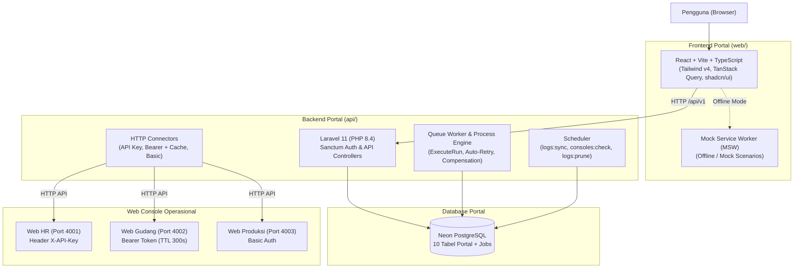

# Console Hub — Portal Pengatur Proses Multi-Console

[](https://laravel.com)
[](https://react.dev)
[](https://www.typescriptlang.org)
[](https://tailwindcss.com)
[](https://neon.tech)
[](#pengujian--kualitas)

Console Hub adalah satu website pusat kendali (*command center*) yang menghubungkan beberapa web console operasional (HR, Gudang, dan Produksi) melalui HTTP API backend masing-masing.

Melalui satu portal terpadu, tim operasional dapat:
1. **Log Gabungan**: Menarik, menyeragamkan, dan memfilter log dari berbagai console dalam satu tabel terpusat.
2. **Atur Data Operasional**: Melihat dan mengubah data master di console lain (contoh: harga produk, master barang, data karyawan) dengan pencatatan riwayat audit (*old vs new values*).
3. **Proses Lintas Console**: Mengorkestrasi urutan langkah yang memanggil API berbagai console dengan antrean background, live monitoring (polling 2 detik), auto-retry, pembatalan, dan kompensasi otomatis saat gagal.

---

## 🏛️ Arsitektur Sistem



### Prinsip Utama
- **Hanya Lewat API**: Portal tidak pernah membaca atau menulis langsung ke database milik console eksternal. Semua interaksi melewati HTTP API resmi masing-masing console.
- **Database Milik Portal**: Portal memiliki database PostgreSQL sendiri (NeonDB) khusus untuk menyimpan: konfigurasi console, riwayat kesehatan, log tarikan, definisi proses, riwayat eksekusi (*runs*), dan catatan audit.
- **Console Berbasis Data**: Informasi host, tipe autentikasi, endpoint log, dan pemetaan data disimpan sebagai konfigurasi di tabel `consoles`, bukan kode statis.

---

## 📁 Struktur Monorepo

```
console-hub/
├── api/                    # Backend Laravel 11 (PHP 8.4)
│   ├── app/
│   │   ├── Connectors/     # Klien HTTP multi-console (ApiKey, Bearer, Basic, HostGuard)
│   │   ├── Console/        # Artisan commands (logs:sync, consoles:check, logs:prune)
│   │   ├── Http/           # Controllers (Auth, Console, Log, Overview), Middleware, Resources
│   │   ├── Models/         # 10 Model Eloquent portal
│   │   └── Services/       # LogSync, HealthChecker, ProcessEngine, Audit
│   ├── database/           # 10 Tabel migrasi, seeder, dan factory
│   └── tests/              # Pest / PHPUnit Feature & Unit tests
├── web/                    # Frontend React (Vite + TypeScript)
│   ├── src/
│   │   ├── app/            # AppLayout, Router, Providers, Error/Offline banners
│   │   ├── components/     # UI components (shadcn/ui style, StatusDot, LevelBadge)
│   │   ├── features/       # 8 Halaman (auth, overview, consoles, logs, resources, processes, runs, audit)
│   │   ├── lib/            # api.ts, schemas.ts (Zod validation), errors.ts, runs.ts
│   │   └── mocks/          # MSW handlers, dataset dummy, dan skenario interaktif
│   └── docs/               # Catatan desain dan acuan antarmuka
├── docs/                   # Dokumen Teknis, ERD, dan spesifikasi simulasi
├── AGENTS.md               # Panduan & batasan ketat bagi AI Agent
└── CLAUDE.md               # Panduan sistem untuk Claude Code
```

---

## 🛠️ Tech Stack

| Lapisan | Teknologi | Deskripsi |
|---|---|---|
| **Frontend** | React 19, Vite 8, TypeScript | UI SPA dengan TanStack Query, React Router v7, Radix UI (shadcn style), Tailwind CSS v4, Lucide Icons |
| **Frontend Mock** | Mock Service Worker (MSW) | Dukungan pengembangan frontend tanpa dependensi backend langsung |
| **Backend** | Laravel 11 (PHP 8.4) | RESTful API, Laravel Sanctum token auth, queue worker database driver, scheduler |
| **Database** | NeonDB (PostgreSQL) | Serverless PostgreSQL dengan 10 tabel utama portal (`sslmode=require`) |
| **Testing** | Pest, Vitest, Testing Library | Pengujian otomatis backend (`Http::fake`) dan pengujian frontend Vitest |

---

## 🚀 Panduan Memulai Cepat

### Prasyarat
- **PHP**: 8.3 atau 8.4 dengan ekstensi `pdo_pgsql`, `pgsql`, `bcmath`, `curl`, `mbstring`.
- **Composer**: Dependency manager PHP.
- **Node.js**: v20.19+ atau v22.12+ dan `npm`.
- **Database**: Akun atau instance PostgreSQL (NeonDB).

---

### 1. Setup Backend (`api/`)

1. Masuk ke direktori `api`:
   ```bash
   cd api
   ```

2. Pasang dependensi PHP:
   ```bash
   composer install
   ```

3. Siapkan file environment:
   ```bash
   cp .env.example .env
   ```

4. Konfigurasikan koneksi PostgreSQL NeonDB di file `.env`:
   ```env
   DB_CONNECTION=pgsql
   DB_HOST=ep-your-database-pooler.region.aws.neon.tech
   DB_PORT=5432
   DB_DATABASE=neondb
   DB_USERNAME=your_db_user
   DB_PASSWORD=your_db_password
   DB_SSLMODE=require

   # Untuk development lokal
   ALLOW_PRIVATE_HOSTS=true
   SEED_ADMIN_PASSWORD=adminpassword123
   SEED_USER_PASSWORD=operatorpassword123
   ```

5. Buat application key dan jalankan migrasi beserta seeder:
   ```bash
   php artisan key:generate
   php artisan migrate --seed
   ```

6. Jalankan server lokal, queue worker, dan scheduler:
   ```bash
   # Terminal 1: Server API (http://localhost:8000)
   php artisan serve

   # Terminal 2: Queue Worker untuk eksekusi proses
   php artisan queue:work --queue=runs,default

   # Terminal 3 (Opsional): Scheduler penarikan log dan health check
   php artisan schedule:work
   ```

---

### 2. Setup Frontend (`web/`)

1. Masuk ke direktori `web`:
   ```bash
   cd web
   ```

2. Pasang dependensi Node:
   ```bash
   npm install
   ```

3. Siapkan file environment:
   ```bash
   cp .env.example .env
   ```

4. Tentukan mode operasi di `web/.env`:
   - **Mode API Sungguhan (Terhubung ke Laravel)**:
     ```env
     VITE_API_URL=http://localhost:8000/api/v1
     VITE_USE_MOCKS=false
     ```
   - **Mode Mock / Offline (Menggunakan MSW)**:
     ```env
     VITE_API_URL=/api/v1
     VITE_USE_MOCKS=true
     ```

5. Jalankan dev server Vite:
   ```bash
   npm run dev
   # Buka http://localhost:5173
   ```

---

## 🔑 Kredensial Login Default

### 1. Akun Database Nyata (Seeder Laravel)
| Email | Password | Role | Akses |
|---|---|---|---|
| `admin@consolehub.test` | *Sesuai `SEED_ADMIN_PASSWORD` di `.env`* | Admin | Semua fitur termasuk Atur Console & Catatan Audit |
| `operator@consolehub.test` | *Sesuai `SEED_USER_PASSWORD` di `.env`* | Operator | Ringkasan, Console, Log, Atur Data, dan Proses |

### 2. Akun Mock MSW (Frontend Offline)
| Email | Password | Role | Akses |
|---|---|---|---|
| `rina@pabrik-sejahtera.id` | `konsol123` | Admin | Seluruh fitur + Audit |
| `budi@pabrik-sejahtera.id` | `konsol123` | Operator | Fitur operasional standar |

---

## 🖥️ Halaman Utama & Fitur Portal

1. **Login (`/login`)**: Autentikasi token Sanctum dengan penanganan token kedaluwarsa.
2. **Ringkasan / Overview (`/`)**: Kartu ringkasan kesehatan 3 console, grafik/metrik log error 24 jam terakhir, dan daftar eksekusi proses terkini.
3. **Console Hub (`/consoles` & `/consoles/:id`)**: Status tiap console (`ok`, `slow`, `down`), latensi respons, dan tombol uji koneksi instan (*instant ping*).
4. **Log Gabungan (`/logs`)**: Penarikan log otomatis dan manual, filter tingkat log (`debug`, `info`, `warn`, `error`), filter tanggal, pencarian teks, dan modal detail JSON mentah (*raw*).
5. **Atur Data Resources (`/consoles/:id/resources/:key`)**: Melihat tabel data operasional console dan mengedit field yang diizinkan (`writable_fields`) dengan audit nilai lama dan baru secara otomatis.
6. **Definisi Proses (`/processes`)**: Katalog alur kerja lintas console, detail urutan langkah, dan form eksekusi dinamis sesuai `input_schema`.
7. **Eksekusi / Runs (`/runs` & `/runs/:id`)**: Pemantauan proses secara *real-time* lewat polling 2 detik, strip langkah visual, tombol batalkan (*cancel*), dan tombol ulangi dari langkah gagal (*retry*).
8. **Catatan Audit (`/audit`)**: Halaman khusus Admin untuk melacak seluruh aktivitas tulis dan eksekusi pengguna.

---

## 📡 Kontrak API Portal (`/api/v1`)

Semua endpoint diawali dengan prefix `/api/v1` dan mengembalikan respons terbungkus (*envelope standard*):

### Format Sukses
```json
{
  "data": { ... },
  "meta": { "next_cursor": "eyJpZCI6MTAwfQ==", "total": 120 }
}
```

### Format Error Seragam
```json
{
  "error": {
    "code": "CONSOLE_TIMEOUT",
    "message": "Web Produksi tidak merespons dalam batas waktu",
    "console": "produksi",
    "fields": {},
    "details": {}
  }
}
```

### Ringkasan Endpoint

| Endpoint | Metode | Role | Keterangan |
|---|---|---|---|
| `/auth/login` | POST | Publik | Autentikasi dan penerbitan token |
| `/auth/logout` | POST | User | Pencabutan token aktif |
| `/auth/me` | GET | User | Profil user login saat ini |
| `/overview` | GET | User | Metrik ringkasan status & log |
| `/consoles` | GET / POST | User / Admin | Daftar console & pendaftaran console baru |
| `/consoles/{id}/test` | POST | User | Uji konektivitas dan latensi console |
| `/consoles/{id}/resources/{key}` | GET / PATCH | User | Baca data & ubah field yang diizinkan |
| `/logs` | GET | User | Log gabungan dengan pagination kursor |
| `/logs/sync` | POST | User | Tarik log terbaru dari console |
| `/processes` | GET / POST | User / Admin | Daftar & konfigurasi alur proses |
| `/processes/{id}/runs` | POST | User | Eksekusi proses ke antrean background |
| `/runs/{id}` | GET | User | Status eksekusi & detail langkah |
| `/runs/{id}/cancel` | POST | User | Batalkan eksekusi yang sedang berjalan |
| `/runs/{id}/retry` | POST | User | Ulangi eksekusi mulai dari langkah gagal |
| `/audit` | GET | Admin | Audit trail seluruh aksi tulis |

---

## 🧪 Pengujian & Kualitas

### Menjalankan Tes Backend:
```bash
cd api
./vendor/bin/pest
```

### Menjalankan Tes Frontend:
```bash
cd web
npm test            # Menjalankan 13 test files (Vitest + Testing Library)
npm run typecheck   # Validasi tipe TypeScript ketat
npm run build       # Validasi bundle production build
```

---

## 👥 Pembagian Peran & Batasan Tim

Proyek ini dibangun melalui pembagian tanggung jawab yang jelas:

- **Fullstack (Laravel + React) [Role Proyek Ini]**: Mengembangkan aplikasi `api/` dan `web/` hingga siap di lingkungan lokal dan staging, memenuhi seluruh kontrak API, dan menjamin test passing.
- **Cloud (NeonDB & Infrastruktur)**: Mengelola project/branch Neon, cloud staging hosting, deployment worker/scheduler, CI/CD pipeline, serta `docs/ops.md`.
- **DB Schema**: Merancang DDL / ERD awal, kamus data, dan dataset mock console.

> [!IMPORTANT]
> **Non-Goals (Di luar ruang lingkup proyek)**:
> 1. Tidak menggunakan editor visual drag-and-drop ala n8n (cukup antarmuka daftar langkah).
> 2. Tidak mendukung percabangan atau perulangan rumit pada mesin proses (hanya urutan sekuensial).
> 3. Tidak ada manajemen permission kompleks (cukup 1 role standar + flag `is_admin`).
> 4. Tidak ada koneksi database langsung ke console eksternal (100% via API resmi).
> 5. Tidak memakai WebSocket (pemantauan status menggunakan polling 2 detik).
